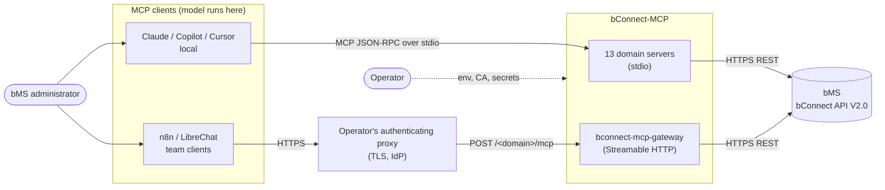
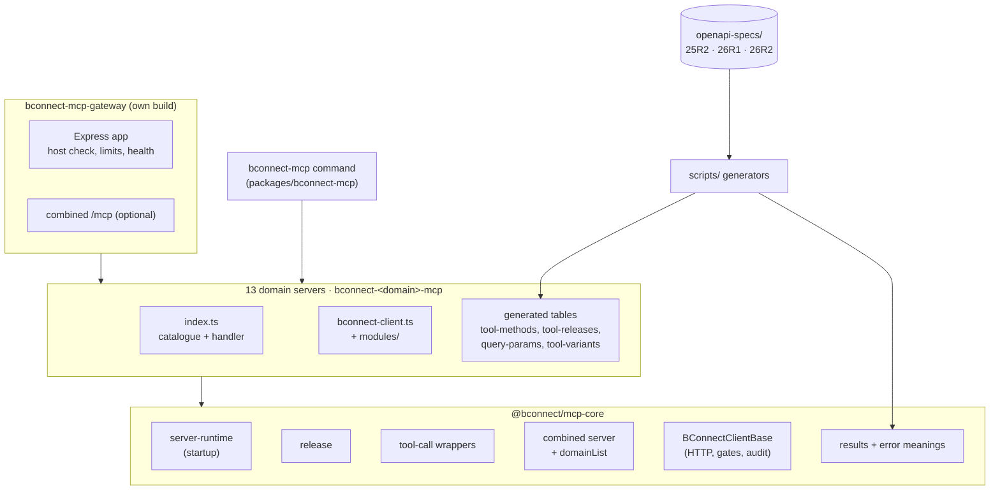
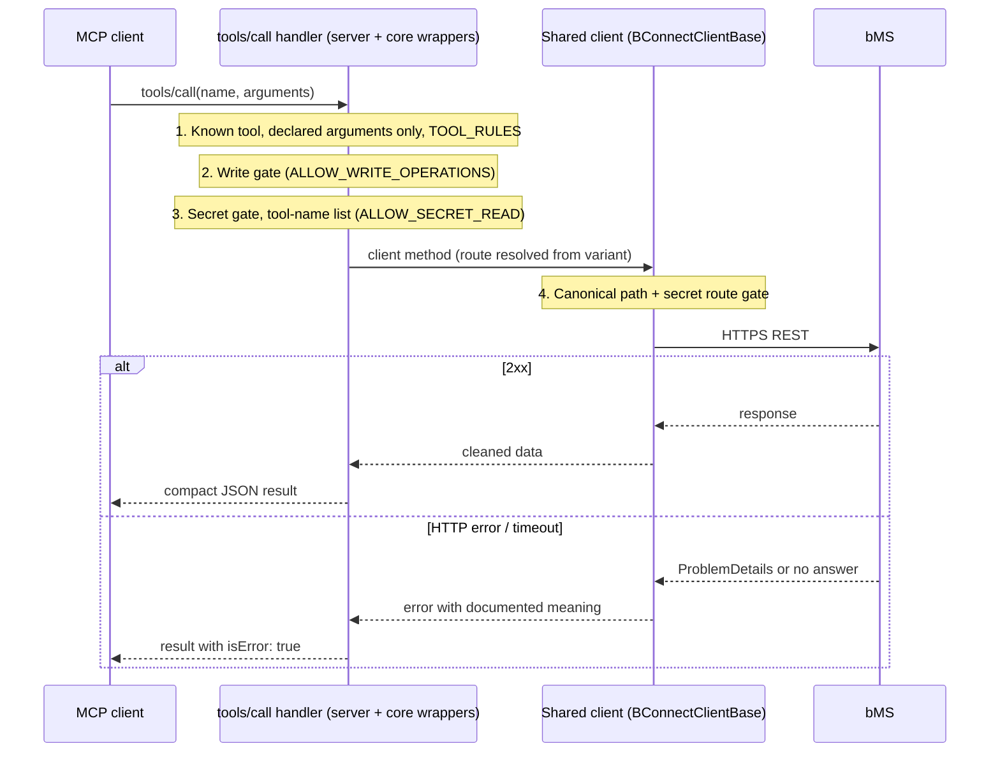
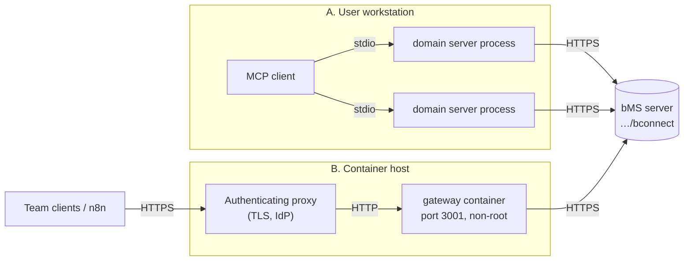

# bConnect-MCP — arc42 Architecture Documentation

As of 2026-11-23 (v26.1.12 plus `main`). Structure: [arc42](https://arc42.org), sections 1–12.

## 1. Introduction and Goals

bConnect-MCP lets AI assistants (Claude, GitHub Copilot, Cursor, n8n and other MCP clients) read and manage a baramundi Management Suite (bMS) through the bConnect REST API V2.0. It is a TypeScript npm-workspaces monorepo at version 26.1.12, in Technical Preview, MIT-licensed.

### 1.1 Requirements overview

- **Coverage:** 220 tools on bMS 26R2, 211 on 26R1 and 166 on 25R2, split across 13 domain servers (endpoints, jobs, software, assets, compliance and others). The target is 100 % of the V2.0 API.
- **Release awareness:** each server detects the bMS release at startup and lists only the tools whose routes that release has.
- **Safe by default:** writes and secret reads are off unless switched on; the HTTP gateway always keeps them off.
- **Ways to run:** local stdio processes per user (one per domain, or several domains as one server with the `bconnect-mcp` command), or one HTTP gateway (container) for teams and n8n.
- **Persona:** a senior IT administrator who uses an AI assistant to query, configure and automate device management.

Requirement IDs (REQ-SRV, REQ-SPLIT, REQ-GW, REQ-CI, REQ-QA, REQ-XC, REQ-DEP) refer to the project's internal requirements catalogue.

### 1.2 Quality goals

| Priority | Quality goal | What it means here |
| --- | --- | --- |
| 1 | Security | Secrets never reach the model by default; writes are gated; a tool can only reach its own route; security-relevant calls are audited. |
| 2 | Correctness against the API | Every tool call conforms to the OpenAPI spec of the selected release; errors keep the API's documented meaning. |
| 3 | Answer integrity | A partial, paged or rights-limited result says so; an unknown write outcome is reported as unknown. |
| 4 | Context efficiency | Small tool catalogues and compact results, because every byte sits in the model's context. |
| 5 | Maintainability | One shared core, generated types and guards in CI, so a fix applies to all 13 servers. |

### 1.3 Stakeholders

| Role | Expectation |
| --- | --- |
| bMS administrator (end user) | Ask in natural language; get trustworthy answers; no accidental changes. |
| Platform / security team | Run the gateway behind their IdP and proxy; least-privilege service account; audit trail. |
| Workflow builders (n8n) | One stable HTTP endpoint for all domains. |
| Contributors | Small, reviewable PRs; a template for new servers; CI that catches mistakes. |
| baramundi product management | Coverage of new bMS releases (26R2) and a clear Technical Preview stance. |

## 2. Architecture Constraints

The bConnect REST API V2.0 is the only interface to the bMS. Its OpenAPI specs per release (`openapi-specs/25R2`, `26R1`, `26R2`) are the source of truth for every tool.

### 2.1 Technical constraints

| Constraint | Background |
| --- | --- |
| TypeScript on Node.js `^22.23.4 \|\| ^24.22.1 \|\| >=26.12.1`, ESM | Patched Node floor everywhere (REQ-DEP-003); Node 22.15+ also trusts the OS CA store. ADR-0001 FastMCP question resolved 2026-10-06: stay on TypeScript. |
| `@modelcontextprotocol/sdk` 1.32, axios + axios-retry, Express 5 | One Express major (REQ-DEP-002). |
| Transports: stdio (default) and Streamable HTTP | stdio for local clients; HTTP for the gateway and a loopback-only single-server mode. |
| bMS releases 25R2, 26R1, 26R2 | Routes and schemas differ per release; default fallback `BCONNECT_RELEASE=26R2`. |
| bConnect auth: API key or Basic (ASCII password only) | bConnect rejects non-ASCII passwords; each failed attempt counts toward the account lockout. |
| bMS RBAC is not queryable per caller | A restricted user gets 200 with filtered or empty lists, not 403. The gateway uses one service credential. |
| Container: `node:22-alpine` pinned by digest, non-root user, port 3001, linux/amd64 + arm64 | Published to GHCR with SBOM and provenance attestations. |
| Not on the npm registry yet | Install from source, the release zip, or the container. The package `@baramundi/bconnect-mcp` is prepared as a private workspace; publishing follows (#297). |

### 2.2 Organizational constraints

- Technical Preview: no production guarantee; breaking changes go to [`CHANGELOG.md`](../CHANGELOG.md).
- Small, reviewable PRs; design decisions are accepted in a design review and recorded as ADRs.
- CI on `main` is a required merge gate (REQ-CI-001): build, lint, test-type-check, cast guard, tests on Linux and Windows, coverage floors, mock tier for each release.
- Live verification against a real bMS runs by hand (REQ-QA-004); a write tool without it is marked "Not yet verified against a live bMS."
- Releases follow the bMS naming (`26.1.x` for 26R1-era releases; `26.2.0` next).

### 2.3 Conventions

- One tool per API operation; type arguments select route variants (ADR-0015).
- Tool names follow `<verb>_<object>[_by_<parent>]` (`list_job_instances_by_endpoint`, `run_msw_cleanup`), and the ID of the tool's own object is `id`; see [TOOL_NAMING.md](TOOL_NAMING.md). A guard checks every tool. A renamed tool or argument stays in the server's `replaced-tools.ts`: a call under the old name doesn't run and answers with its replacement.
- No new type-defeating casts (`scripts/check-new-casts.sh`); generated API types are used in handlers (REQ-QA-002).
- Every setting is read through the core and documented in [CONFIGURATION.md](CONFIGURATION.md); a guard checks it.

## 3. Context and Scope

bConnect-MCP talks to exactly one bMS per configuration and to MCP clients; it never talks to an LLM itself. The model runs in the client, which decides what to call.

Local assistants start a domain server over stdio. Team clients reach the gateway through an operator's authenticating proxy.

### 3.1 Business context

| Partner | Input to bConnect-MCP | Output from bConnect-MCP |
| --- | --- | --- |
| MCP client + its model (Claude, Copilot, Cursor, n8n, LibreChat) | `tools/list`, `tools/call` with arguments | Tool catalogue with annotations; compact JSON results or error results with the documented meaning |
| bMS administrator | Natural-language requests, via the client | Answers about endpoints, jobs, software, compliance; changes only when writes are on |
| bMS (bConnect API V2.0) | Responses, `ProblemDetails` errors, server version | REST calls with API key or Basic auth |
| Operator | Env settings, CA certificate, Docker secrets, proxy | Startup log (detected release), audit log, `/health` |

### 3.2 Technical context

| Channel | Protocol | Notes |
| --- | --- | --- |
| Client ↔ domain server | MCP JSON-RPC over stdio | stdout is JSON-RPC only; logs and audit go to stderr |
| Client ↔ gateway | MCP Streamable HTTP, `POST /<domain>/mcp` or `POST /mcp` (combined, off by default) | Stateless transport; TLS and authentication at the proxy |
| Single server, HTTP mode | `MCP_TRANSPORT=http` | Loopback only, no authentication, for local use |
| Server / gateway ↔ bMS | HTTPS REST to `BCONNECT_BASE_URL` (`…/bconnect`) | Keep-alive; 30 s default timeout; redirects not followed |

**Out of scope:** authentication of gateway callers (the operator's proxy), the LLM and its prompts, and bMS RBAC administration.

## 4. Solution Strategy

The strategy: thin domain servers on one shared core, with every rule derived from the OpenAPI specs and enforced in that core.

| Quality goal | Approach | Decision |
| --- | --- | --- |
| Context efficiency | Split the API into 13 domain servers by spec, so a user loads only the domains they need. One tool per operation, with type arguments instead of one tool per route variant. Write tools are left out of `tools/list` while writes are off. Compact JSON results; `countOnly` on paged lists. Several domains can still be served as one server (`bconnect-mcp endpoints,jobs`, the gateway's `/mcp`). | ADR-0000, ADR-0015, ADR-0012, ADR-0011, ADR-0013 |
| Maintainability | One shared library `@bconnect/mcp-core` in an npm-workspaces monorepo: HTTP client, config, startup, validation, errors, results, audit. A server holds only its tool definitions and handlers. A template scaffolds new servers. | ADR-0002, ADR-0007, ADR-0010 |
| Correctness against the API | Types, query tables and error meanings are generated from the specs and committed; guards in CI regenerate and compare. Each tool declares its operation, and a traffic guard checks every call against the spec of the selected release. | ADR-0006, REQ-QA-001, REQ-QA-005 |
| Release awareness | The core reads the bMS version once at startup and selects the release in one place; every release-dependent decision asks it. | ADR-0014 |
| Security | Safe defaults (writes off, secret reads off, TLS on). Two locks for secrets: the tool-name list and a route gate in the shared client, classified by response schema. Arguments are validated per tool; the client refuses non-canonical paths. bMS text is cleaned of invisible characters. | ADR-0004, ADR-0005, ADR-0009 |
| Security (gateway) | No first-party authentication: an operator's TLS-terminating, authenticating proxy owns identity. The gateway keeps write and secret gates closed and refuses a non-loopback bind without `MCP_ALLOW_NO_AUTH=true`. | ADR-0001, ADR-0003 |
| Answer integrity | bConnect errors are tool results with the API's documented meaning, not protocol errors. Writes are never retried; an unanswered write is reported as "outcome unknown". | ADR-0008, REQ-XC-003, REQ-XC-005 |

Technology: TypeScript on Node.js with the official MCP SDK, rather than Python FastMCP (decided 2026-10-06). One codebase serves stdio, the single-server HTTP mode, the `bconnect-mcp` command and the gateway.

## 5. Building Block View

The repository is an npm-workspaces monorepo: `@bconnect/mcp-core`, the `bconnect-mcp` command package, 13 domain servers and a template are workspace members. The gateway builds separately and bundles them all.

A fix in the core applies to all 13 servers at once; a server holds only what is specific to its domain.

### 5.1 Level 1

| Building block | Responsibility | Location |
| --- | --- | --- |
| Domain server (×13) | Declares its tools (name, description, input schema, operation), maps arguments to bConnect calls, applies domain rules (e.g. maintenance-window intervals) | `bconnect-<domain>-mcp/src/` |
| `@bconnect/mcp-core` | Everything shared: HTTP client, config, startup, gates, validation, results, errors, release selection, audit, the combined server and its domain-list parser (`domainList`, used by the command and `MCP_GATEWAY_COMBINED`) | `packages/mcp-core/src/` |
| `bconnect-mcp` command | `bconnect-mcp <domain>`, `<domain>,<domain>` or `all`: one or several domains as one stdio (or HTTP) server, with the same startup as a domain server; package `@baramundi/bconnect-mcp`, still private | `packages/bconnect-mcp/` |
| Gateway | Hosts all servers in one Express process over Streamable HTTP; health check, limits, `*_FILE` secrets, closed gates | `bconnect-mcp-gateway/src/` |
| Server template | Starting point for a new domain server | `bconnect-server-template/` |
| Specs + generators | Per-release OpenAPI specs; scripts that generate types, query tables and error meanings | `openapi-specs/`, `scripts/` |
| Suite-wide tests | Guards across all servers (spec conformance, secret gate, docs) | `__tests__/` |

### 5.2 Level 2: inside a domain server

| File | Content |
| --- | --- |
| `index.ts` | `createServer()`: tool catalogue and `tools/call` handler; ends with `runServer(...)` |
| `bconnect-client.ts` | Domain client = core `BConnectClientBase` + domain methods |
| `tool-releases.ts` | Which releases have each tool |
| `tool-variants.ts` | Route variants per merged tool and their selectors (ADR-0015) |
| `tool-methods.ts`, `operations.ts` | HTTP method and declared operation per tool (write classification, spec guard) |
| `query-params.ts`, `create-fields.ts`, `update-fields.ts` | Query tables and body fields per route |
| `generated/` | OpenAPI types per release (generated, committed) |

### 5.3 Level 2: the core's tool-call wrappers

A server's `tools/list` and `tools/call` handlers are composed from core wrappers, each adding one concern: `withReleaseTools` (only the release's tools), `withWriteToolsHidden`, `withToolVariants` (selector → route), `withCountOnly` (which also adds the empty-list hint, `withEmptyListHint`), `withQueryProperties`, `withUnverifiedWriteMarker`, `withToolAnnotations` and `declaredArgumentsOnly` (refuse unknown arguments).

### 5.4 How a tool is implemented

A tool is hand-written in only three places: its definition, its validation rule and its handler case. Everything else about it is generated from the specs or derived in the core. The hand-written parts are pinned to the spec by `operations.ts`, which names the bConnect `operationId` each tool calls.

| Piece | File | Written by | Example: `get_logical_group` / `list_logical_groups` |
| --- | --- | --- | --- |
| Operation binding | `src/operations.ts` | Hand, one line per tool or route variant | `get_logical_group: ['GetLogicalGroup']`; merged tools have one line per variant, e.g. `'list_endpoints[type=WindowsEndpoint]': ['GetWindowsEndpoints']` |
| Tool definition | `src/index.ts`, `ListTools` catalogue | Hand | `name`, `description`, `inputSchema` (`id: string`, required) |
| Argument rule | `src/utils/mcp-tool-validation-rules.ts` (`TOOL_RULES`) | Hand | Rules for `id`, checked by `validateOrThrow` before the handler runs |
| Handler case | `src/index.ts`, `switch (route)` in `CallTool` | Hand, a few lines | `bconnect.endpoints.getLogicalGroup(args.id)`, then `toolJsonResult(result)` |
| Client method | `src/modules/<domain>.ts` | Hand, typed with the generated API types | `GET <basePath>/LogicalGroups/{id}` through the shared client |
| HTTP methods | `src/tool-methods.ts` | Generated | `get_logical_group: ["GET"]`: read-only, so `readOnlyHint: true` and not a write tool |
| Releases | `src/tool-releases.ts` | Generated | `["25R2", "26R1", "26R2"]` |
| Query parameters | `src/query-params.ts` | Generated, per release | `list_logical_groups`: `OrderBy`, `SearchQuery`, `Name`, `Dip`, `Domain`, `Page`, `PageSize`, `countOnly`, with the spec's texts |
| Variants | `src/tool-variants.ts` | Generated | `list_endpoints`: its route per `type` value (ADR-0015) |
| API types | `src/generated/*-types.ts` | Generated | `LogicalGroup`, request and response shapes |
| Live verification (writes) | core `unverified-writes.ts` | Hand, after a live run | Write tools without an entry end their description with "Not yet verified against a live bMS." |

The handler stays thin because the core wraps it. List tools send only the parameters the generated table allows for the selected release (`pickArguments(args, sends(route))`). A merged tool's `type` argument is resolved into a route key such as `list_endpoints[type=WindowsEndpoint]` before the `switch` (`withToolVariants`). Write tools build the body from `create-fields.ts` / `update-fields.ts`; updates send a JSON Patch, and a call that changes nothing is refused.

**Adding a tool**, following the steps at the top of `bconnect-server-template/src/index.ts`:

1. Add the `operationId` line to `operations.ts`.
2. Run `node scripts/generate-query-parameters.mjs` to regenerate methods, releases, query tables and variants. Run `scripts/generate-api-types.mjs` if the specs changed.
3. Add the client method, the catalogue entry (named by [TOOL_NAMING.md](TOOL_NAMING.md)), the validation rule and the handler case.
4. For a write tool, add it to `WRITE_TOOLS`. A destructive write without DELETE also goes into the core's `DESTRUCTIVE_WRITE_TOOLS`, with its reason. If the answer carries a credential, add it to the secret-gate lists.
5. Run the suite. The guards fail until everything is consistent: spec conformance, tool names, tool annotations, write tools hidden, `countOnly`, release tools, README tool counts and secret gate.
6. Test through the mock tier for every release; a write tool counts as done only after a recorded live run.

## 6. Runtime View

### 6.1 A tool call

The first three checks run in the server's `tools/call` handler; the fourth runs in the shared HTTP client, so it also catches a tool that forgot its own check.

Every refusal keeps its own wording and sends nothing to the bMS. A bConnect error is a tool result (`isError: true`), never a protocol error.

### 6.2 Server startup

The same routine starts a domain server and the `bconnect-mcp` command.

1. Load the env file (`node --env-file`, or `.env` in the working directory) and, in the gateway, the `*_FILE` secrets.
2. Validate every setting; an invalid one stops the server and names the variable.
3. Build the one client for this process: credentials, CA, keep-alive agent, rate limiter, audit logger.
4. Detect the release: `GET /servermanagement/v2.0/ManagementServer`, one try within 10 s. The log says e.g. `bMS 26.2.147.11 → release 26R2`. If it fails, use `BCONNECT_RELEASE`, else the default `26R2`, with a warning that says why.
5. Stop a server that needs a later release (compliance and UDG on 25R2) with "needs bMS 26R1 or 26R2".
6. For the command: list the chosen domains once; a domain named on its own that has no tools in the release stops the start, and no two domains may list the same tool. Check the connection; on failure stop with `cannot reach bConnect API (<cause>)`.
7. Connect the transport: stdio, or Streamable HTTP in HTTP mode or the gateway.

### 6.3 Gateway request

The proxy authenticates the caller and forwards `POST /<domain>/mcp`. The gateway checks Host and Origin, the rate limit and the body size, then creates a stateless Streamable HTTP transport for the request (`sessionIdGenerator: undefined`) and hands it to that domain's server, which runs the path above. With `MCP_GATEWAY_COMBINED`, `POST /mcp` serves the chosen domains as one server: `tools/list` merges their catalogues, and `tools/call` goes to the domain that lists the tool; the `bconnect-mcp` command uses the same combined server over stdio. `GET /health` answers `{"status":"ok"}`.

### 6.4 Special paths

- **`countOnly`:** the wrapper sends the same filters with `PageSize=1` and returns `{"totalItems":…,"filters":{…}}`, or says the count is unavailable.
- **404 or empty answer on a per-object list:** for example `list_detected_vulnerabilities_by_endpoint` or `list_kiosk_releases_by_job_definition`. The tool checks whether the parent object exists, then says which case applies; it never reports "no findings" without a confirmed parent.
- **Empty, unfiltered list:** when a `list_*` tool returns no entries (or a count of 0) and the caller gave no filter and asked for the first page, the result gets a second text after the JSON: bMS also returns an empty list when the account has no rights on these objects. The JSON stays as it was; filtered lists get no hint.
- **Unknown write outcome:** a write that times out, loses its connection or gets 502/504 is not retried. The result tells the model to read the object back first.

## 7. Deployment View

One user runs the servers as local processes their client starts. A team runs one gateway container behind its own authenticating proxy. Both reach the same bMS over HTTPS.

The gateway binds `127.0.0.1` by default; any other bind needs `MCP_ALLOW_NO_AUTH=true`, the operator's assertion that a proxy authenticates callers.

| Option | Artifact | Runs as | Writes / secrets | Use for |
| --- | --- | --- | --- | --- |
| A1 Release download | `bconnect-mcp-suite-<version>.zip` + `.sha256` + CycloneDX SBOM | Node processes over stdio, started by the client | Off by default; `ALLOW_WRITE_OPERATIONS`, `ALLOW_SECRET_READ` | One user, a fixed version, no build tools |
| A2 From source | `git clone`, `npm ci`, `npm run build` | Same as A1 | Same as A1 | Newest `main`, contributors |
| A3 Single server, HTTP mode | Same build, `MCP_TRANSPORT=http` | One loopback HTTP server, no authentication | Same as A1 | Local HTTP-only clients |
| B Gateway container | `ghcr.io/baramundisoftware/bconnect-mcp-gateway:<version>`; SBOM + provenance attested | One Express process hosting all 13 servers, port 3001 | Always off | Teams, n8n, LibreChat; `docker-compose.gateway.yml` |

The gateway can also run from a source build without Docker ([INSTALLATION.md](INSTALLATION.md), option C). Its settings are `MCP_GATEWAY_PORT` (3001), `MCP_GATEWAY_BIND` (127.0.0.1), `MCP_GATEWAY_ALLOWED_HOSTS`, `MCP_GATEWAY_COMBINED` and trust-proxy, plus the `BCONNECT_*` connection settings. See [DOCKER.md](DOCKER.md).

## 8. Crosscutting Concepts

Every concept below lives once in `@bconnect/mcp-core`. A server can't implement its own version of it.

### 8.1 Security gates

- **Write gate** (`ALLOW_WRITE_OPERATIONS`, default off). A tool is a write by the HTTP method of its declared operation. While writes are off, `tools/list` leaves write tools out and a call by name is refused before any request (ADR-0012).
- **Secret gate** (`ALLOW_SECRET_READ`, default off). An operation is secret-bearing when a 2xx response schema has a string field named like `pin`, `password`, `recoverykey`, `secret`, `token`, `apikey`, `privatekey` or `credential`. There are two locks: the server's tool-name list and `secret-routes.ts` in the shared client, which checks the request itself (ADR-0004). Creating an API key needs both gates.
- **Path lock.** Arguments are validated per tool; unknown arguments are refused (`-32602`); the client refuses non-canonical paths, so a tool reaches only its own route (ADR-0005).
- **Transport.** HTTPS only, except to localhost or with `BCONNECT_ALLOW_INSECURE_HTTP=true`. Redirects are not followed. Custom CAs come through `BCONNECT_CA_CERT_PATH`. The HTTP transports check `Host` and `Origin` against an allow-list (`host-check.ts`).
- **LLM-specific threats.** Text from bMS is cleaned of control, invisible and direction-changing characters (`model-text.ts`, ADR-0009). Secrets never reach the model by default (REQ-XC-006).
- **Tool annotations.** Every tool carries `title`, `readOnlyHint` and, on non-read tools, `destructiveHint`, all derived from its operations. They are hints for the client; the gates decide.

### 8.2 Configuration

One function in the core builds the client config from the environment (ADR-0007). Every setting is validated at startup; an invalid value stops the server and names the variable (REQ-XC-002). The gateway also reads `*_FILE` Docker secrets. The reference is [CONFIGURATION.md](CONFIGURATION.md), which a guard keeps in step with the code.

### 8.3 Error handling

- A bConnect HTTP error becomes a tool result with `isError: true`, carrying the status, the call, the spec's documented meaning for that operation and status (`error-meanings.ts`, generated) and bConnect's own `ProblemDetails` text. Host names, URLs, stacks and credentials are left out (ADR-0008).
- Protocol errors are reserved for MCP faults: unknown tool, invalid arguments.
- Gate refusals keep their own wording and never send a request.
- A write that timed out, lost its connection, or got 502/504 is reported as **outcome unknown**, with advice to read the object back before repeating it.

### 8.4 Results and context budget

Results are compact JSON (`BCONNECT_PRETTY_JSON=true` for debugging). Paging follows the API contract: `Page` 0-based, `PageSize` up to 1000. `countOnly: true` answers "how many?" with one `PageSize=1` call. Incomplete results say so: the first page only, sub-groups not included, existence not confirmed, or an empty list that missing rights can explain.

### 8.5 Resilience

- One client per server process, reused across calls with keep-alive (ADR-0010).
- Reads are retried with exponential backoff (axios-retry); writes never are.
- The default timeout is 30 s (`BCONNECT_TIMEOUT_MS`); slow lists such as vulnerabilities need about 90 s on a large bMS.
- An optional token-bucket rate limiter caps the requests per server (`BCONNECT_RATE_LIMIT_ENABLED`); the gateway adds its own request limit and body-size cap.
- An LRU response cache with TTL is available in the core.

### 8.6 Audit and logging

Audit goes to stderr, never to stdout, which carries JSON-RPC in stdio mode. `BCONNECT_AUDIT_LEVEL` = `security` (default) records every call to a security-relevant route: API keys, LAPS, BitLocker, object rights, security groups and profiles, plus writes to the management server, microservices and variables. `write` and `all` record more; `none` switches audit off. The route list is derived from the spec tags and checked by a guard. The gateway also writes an access log ([AUDIT.md](AUDIT.md)).

### 8.7 Testing and guards

| Tier | What it proves | Where it runs |
| --- | --- | --- |
| Unit + guard tests (vitest) | Handlers, the core, and about 40 suite-wide guards: spec conformance, secret gate, security routes, generated types, error meanings, README and env docs, tool names | CI on Linux and Windows, every PR |
| Mock tier (`scripts/mock-tier.mjs`) | Every tool through the real MCP servers against bConnect-Mock, for each release (25R2, 26R1, 26R2), profile `standard-readwrite` | CI, every PR |
| Live tier (`vitest.live.config.ts`) | Read-only calls and selected writes against a real bMS | By hand, against a test bMS |
| Combined check (`scripts/check-combined.mjs`) | The gateway's combined endpoint | With the live run |

Type-defeating casts are blocked by `scripts/check-new-casts.sh`; CodeQL scans `main` (REQ-QA-008). See [MOCK_INTEGRATION_TESTING.md](MOCK_INTEGRATION_TESTING.md) and [LIVE_BMS_TESTING.md](LIVE_BMS_TESTING.md).

### 8.8 Supply chain

The release zip ships with a SHA-256 checksum and a CycloneDX SBOM. The container image is built with a pinned base digest and carries an SBOM (syft) and provenance attestations. Renovate keeps dependencies current; a release ships no dependency with a known high or critical advisory (REQ-DEP-001).

## 9. Architecture Decisions

Sixteen ADRs record the architecture; they are kept in the project's internal records. The TypeScript-vs-FastMCP question was decided on 2026-10-06: stay on TypeScript.

| ADR | Decision | Status |
| --- | --- | --- |
| 0015 | One tool per operation; type arguments select generated route variants (`tool[type=…]`) | Implemented 2026-10-07 |
| 0014 | The bMS release is detected at startup and selected in one place in the core | Implemented 2026-10-07 |
| 0013 | `countOnly` as a client-side option, served by one call wrapper | Implemented 2026-10-07 |
| 0012 | With writes off, `tools/list` leaves out the write tools | Implemented 2026-10-07 |
| 0011 | Tool results are formatted in the core, as compact JSON | Implemented 2026-10-06 |
| 0010 | One startup routine and one shared client per server, in the core | Implemented 2026-10-06 |
| 0009 | bMS data is cleaned of hidden characters once, in the shared client | Accepted 2026-10-02 |
| 0008 | bConnect errors are tool results with the API's documented meaning | Accepted 2026-10-02 |
| 0007 | One core function builds every server's client config from the environment | Accepted 2026-10-01 |
| 0006 | Tools declare their API operation; a traffic guard checks them against the spec | Accepted 2026-10-01 |
| 0005 | Tool arguments are validated per tool; the client refuses non-canonical paths | Accepted 2026-09-30 |
| 0004 | Secret gate: classify by response schema, verify by traffic, enforce twice | Accepted 2026-09-30 |
| 0003 | Gateway auth redesign: no token map, authentication moves to the operator's proxy / IdP | Accepted 2026-07-10 |
| 0002 | Shared `@bconnect/mcp-core` via npm workspaces (\~22k duplicated lines removed) | Implemented |
| 0001 | Reverse proxy for TLS termination and edge rate limiting | Partly superseded by 0003 (2026-07-10) |
| 0000 | File-based server split: one MCP server per OpenAPI spec, plus the groups server | Accepted 2026-03-30 |

## 10. Quality Requirements

The quality goals in section 1.2 become the testable scenarios below. Most are enforced by a CI guard, so a regression fails a PR instead of reaching a release.

### 10.1 Quality tree

- **Security:** confidentiality of secrets · change control (write gate) · route isolation · auditability · safe defaults
- **Correctness:** spec conformance per release · documented error meanings · release awareness
- **Answer integrity:** complete-or-labelled results · unknown write outcomes · rights-limited lists
- **Context efficiency:** catalogue size · result size · per-domain loading
- **Maintainability:** one core · generated code · guards · template for new servers
- **Operability:** clear startup failures · one config guide · container with health check

### 10.2 Quality scenarios

| ID | Quality | Stimulus | Expected response | Checked by |
| --- | --- | --- | --- | --- |
| QS-1 | Security | The model calls `get_bitlocker_secrets` with default settings | Refused before any request; the tool isn't in `tools/list` | Secret-gate guard, unit tests |
| QS-2 | Security | A new bMS release adds an operation whose answer holds a `password` string | CI fails until the operation is gated or allow-listed with a reason | `secret-gate.guard.test.ts` |
| QS-3 | Security | A tool argument tries to change the request path | `-32602 Invalid parameters` naming the argument; nothing is sent | `tool-argument-routes.guard.test.ts` |
| QS-4 | Security | The gateway is started on `0.0.0.0` without `MCP_ALLOW_NO_AUTH=true` | The gateway refuses to start | Gateway tests |
| QS-5 | Correctness | Any tool is called on any supported release | The request matches the operation's method, path and parameters in that release's spec | `spec-conformance.guard.test.ts`, mock tier |
| QS-6 | Correctness | A server starts against a 25R2 bMS | It logs the detected release and lists only 25R2 tools; compliance and UDG servers stop with "needs bMS 26R1 or 26R2" | Release tests, live tier |
| QS-7 | Answer integrity | A write times out after 30 s | The result says the outcome is unknown and to read the object back before repeating | Unit tests (REQ-XC-003 AC 6) |
| QS-8 | Answer integrity | `list_detected_vulnerabilities_by_endpoint` gets a 404 | The tool checks whether the endpoint exists and says which case applies | Unit tests (REQ-XC-005 AC 4) |
| QS-9 | Context efficiency | A client connects with writes off on 26R1 | 130 tools instead of 211; about 66 KB (≈ 19,000 tokens) less | `readme-tools.guard.test.ts` |
| QS-10 | Context efficiency | The model asks "how many Windows endpoints?" | One `PageSize=1` call; a 54-byte answer instead of 8.8 KB | `count-only.guard.test.ts` |
| QS-11 | Maintainability | Someone edits a generated type file by hand | CI fails until it matches the generator's output | `generated-types.guard.test.ts` |
| QS-12 | Operability | `BCONNECT_BASE_URL` points at the wrong host | The server stops at startup with `cannot reach bConnect API` and the cause in brackets | Startup tests |

## 11. Risks and Technical Debt

The largest open risk is the gateway's missing built-in authentication: its security rests entirely on the operator's proxy and on a least-privilege service account.

### 11.1 Risks

| Risk | Impact | Mitigation today | Open |
| --- | --- | --- | --- |
| Gateway has no authentication (ADR-0003) | Anyone who reaches the port can call every read tool with the service credential | Refuses a non-loopback bind without `MCP_ALLOW_NO_AUTH=true`; write and secret gates forced off; Host/Origin check; docs require an authenticating proxy | Built-in authentication is not decided yet |
| One service credential for all gateway callers | No per-user bMS RBAC; the audit can't name the bMS user | Least-privilege account recommended; proxy access log | Per-user credentials |
| bMS RBAC answers with filtered lists, not 403 | A restricted account looks like a smaller estate | An empty, unfiltered list says that missing rights can be the cause; [TROUBLESHOOTING.md](TROUBLESHOOTING.md) describes the check | API-level signal (upstream request) |
| Write tools not verified live | A write may behave differently on a real bMS than on the mock | "Not yet verified against a live bMS." in the description; live run list (`LIVE_VERIFIED_WRITE_TOOLS`) | Live runs for the remaining write tools |
| Prompt injection through bMS data | Text in bMS fields steers the model | Hidden characters removed; writes and secrets gated; destructive hints | Client-side confirmation is the client's job |
| New bMS release changes routes or schemas | Tools 404 or send invalid bodies | Release detection, per-release specs, spec-conformance guard, mock tier per release | Specs must be fetched for every release |
| Paging signal (`totalPages` nullable) | An internal pager stops too early or too late | REQ-XC-005 AC 2: the pager stops on the API's signal and reports an early stop | — |
| Slow bMS lists (30–50 s) | Timeouts on vulnerability and software lists | `BCONNECT_TIMEOUT_MS`; a write timeout is reported as "outcome unknown" | — |

### 11.2 Technical debt

- Live verification against a real bMS is manual and doesn't run in CI (REQ-QA-004).
- ADRs live in two folders.
- The gateway is not an npm-workspaces member; it bundles the core and all servers in its own build.
- Credentials at rest are plaintext env files or Docker secrets (#60).
- Not on the npm registry or MCP Registry yet: `@baramundi/bconnect-mcp` exists as a private workspace; publishing follows (#297).

## 12. Glossary

| Term | Meaning |
| --- | --- |
| bMS | baramundi Management Suite: the endpoint management product this project connects to |
| bConnect | The bMS REST API (V2.0), with one OpenAPI spec per module and release |
| Release (25R2, 26R1, 26R2) | A bMS version line; each has its own routes and schemas |
| MCP | Model Context Protocol: JSON-RPC protocol through which AI clients discover and call tools |
| Tool | One MCP function; here, one bConnect operation (with type variants) |
| Domain server | One of the 13 `bconnect-<domain>-mcp` processes |
| `bconnect-mcp` | The command that serves one, several or all domains as one MCP server (`packages/bconnect-mcp`) |
| `@bconnect/mcp-core` | The shared library every server and the gateway build on |
| Gateway | `bconnect-mcp-gateway`: serves all domain servers over HTTP at `/<domain>/mcp`, optionally combined at `/mcp` |
| stdio | Transport in which the client starts the server as a child process and talks over stdin/stdout |
| Streamable HTTP | The MCP HTTP transport used by the gateway and the single-server HTTP mode |
| Write gate | `ALLOW_WRITE_OPERATIONS`: whether tools that change bMS data are listed and run |
| Secret gate | `ALLOW_SECRET_READ`: whether tools whose answers carry credentials may run |
| Secret-bearing operation | An operation whose 2xx response schema has a credential-like string field (ADR-0004) |
| Variant / selector | A type argument that picks one of a tool's route variants, written `tool[type=…]` (ADR-0015) |
| `countOnly` | List option that returns only the total, from one `PageSize=1` call |
| Mock tier | Tests through the real servers against bConnect-Mock, per release |
| Live tier | Tests against a real bMS, run by hand |
| Live-verified write | A write tool with a recorded check against a real bMS; others carry the "not yet verified" note |
| UDG | Universal Dynamic Group (26R1 and later) |
| LAPS | Local administrator password solution: managed local admin accounts (defensecontrol) |
| RBAC | The bMS rights model that limits what the API account sees and changes |
